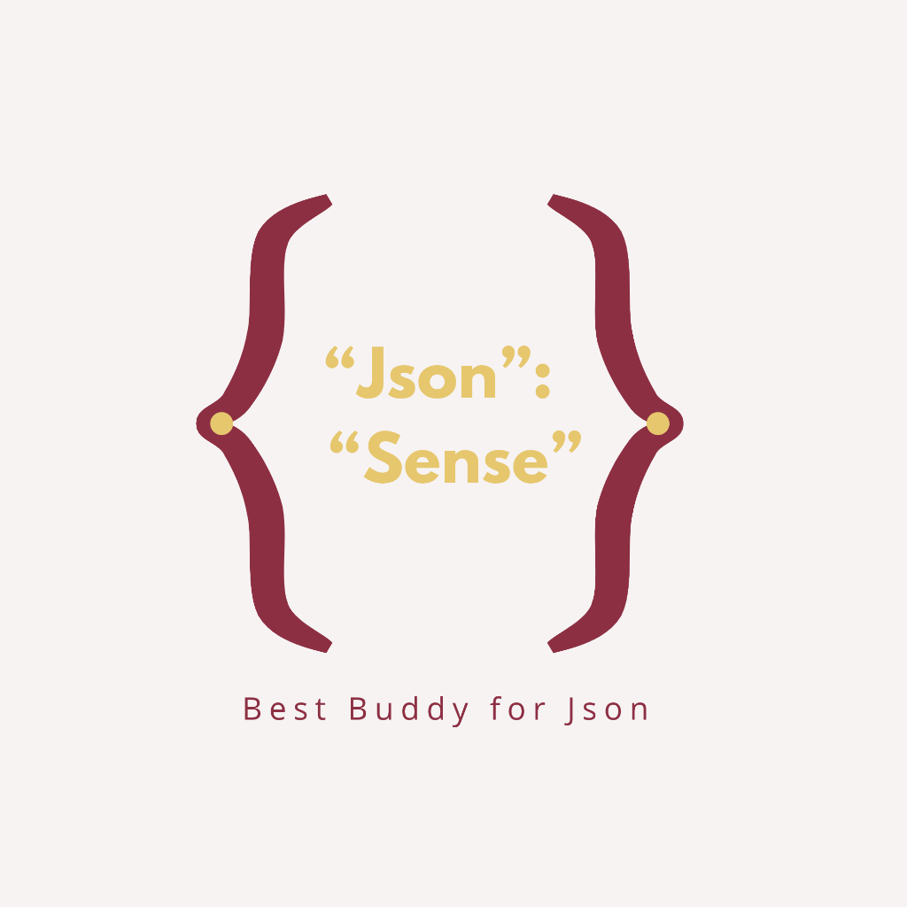

# JsonSense — Best Buddy for JSON



**JsonSense** is a fast, reliable, and 100% private developer tool for inspecting, formatting, validating, comparing, repairing, and transforming JSON data directly in your browser.

> **Zero Network Requests &bull; 100% Client-Side &bull; Data Never Leaves Your Browser**

---

## Features

- **Format & Minify:** 2-space, 4-space, and tab indentation with instant byte, character, and line counters.
- **Syntax Validator:** Friendly syntax error diagnostic with line, column, and error pointer snippet.
- **Smart JSON Repair:** Safely fixes unquoted keys, trailing commas, single quotes, comments, Python/JS literals, and unclosed containers without mutating string contents.
- **Tree Viewer:** Interactive, collapsible hierarchical explorer with instant keyword filtering.
- **JSON to TypeScript:** Generates clean, idiomatic TypeScript interfaces with configurable root names and `export` toggles.
- **JSON Diff:** Side-by-side comparison engine highlighting added, removed, and modified values.
- **Light & Dark Mode:** Built with the signature JsonSense Crimson (`#8d2f43`), Orange Gold (`#e6c76e`), and Light Red (`#f7f3f3`) palette.

---

## Tech Stack

- **React 19**
- **TypeScript**
- **Vite**
- **Tailwind CSS v4**
- **Vitest & React Testing Library**
- **Playwright**

---

## Getting Started

```bash
# Install dependencies
npm install

# Start local development server
npm run dev

# Run unit & component tests
npm test

# Run Playwright E2E tests
npm run test:e2e

# Run production build
npm run build
```

---

## License

MIT &copy; 2026 JsonSense Team
